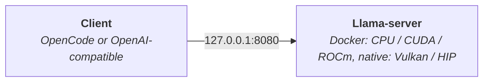
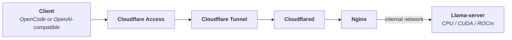

# Llama OpenCode Remote Server

Cross-platform llama.cpp stack: Docker on Linux and native Vulkan/HIP on Windows.

## Table of contents

- [Llama OpenCode Remote Server](#llama-opencode-remote-server)
  - [Table of contents](#table-of-contents)
  - [Compatibility](#compatibility)
  - [Prerequisites](#prerequisites)
  - [Architecture](#architecture)
    - [Local](#local)
    - [Remote](#remote)
  - [Setup](#setup)
  - [Local setup](#local-setup)
    - [1. Initialize](#1-initialize)
    - [2. Check](#2-check)
    - [3. Start](#3-start)
    - [4. Configure the client](#4-configure-the-client)
    - [5. Test](#5-test)
  - [Remote setup](#remote-setup)
    - [1. Create the tunnel](#1-create-the-tunnel)
    - [2. Publish the hostname](#2-publish-the-hostname)
    - [3. Initialize](#3-initialize)
    - [4. Check](#4-check)
    - [5. Start](#5-start)
    - [6. Create a service token](#6-create-a-service-token)
    - [7. Configure Access](#7-configure-access)
    - [8. Configure the client](#8-configure-the-client)
    - [9. Test](#9-test)
  - [Commands](#commands)

## Compatibility

| Backend             | Linux   | Windows     | macOS  |
| ------------------- | ------- | ----------- | ------ |
| CPU                 | ✅     | ✅          | ✅     |
| NVIDIA CUDA         | ✅     | ✅ via WSL2 | ❌     |
| AMD ROCm (Docker)   | ✅     | ❌          | ❌     |
| AMD Vulkan (native) | ❌     | ✅          | ❌     |
| AMD HIP (native)    | ❌     | ✅          | ❌     |

## Prerequisites

- [Docker](https://www.docker.com) — required for Docker backends only
- [llama.cpp Windows release](https://github.com/ggml-org/llama.cpp/releases) — native Vulkan/HIP only
- [Bun](https://bun.sh/)
- [Cloudflare Tunnel](https://developers.cloudflare.com/cloudflare-one/networks/connectors/cloudflare-tunnel/) — remote only
- [Hugging Face CLI](https://huggingface.co/docs/huggingface_hub/guides/cli) — only with `--hf-repository`

## Architecture

### Local



### Remote



## Setup

Install dependencies:

```bash
bun install
```

> You can also use `sfw bun install`.

Copy the environment file:

```bash
cp .env.example .env
```

Edit `.env` to set `BACKEND`, `MODEL_DIRECTORY` (an absolute directory on the host), and `MODEL_FILE` (the GGUF path within that directory). `stack init` reads these settings and writes the secrets. `--force` allows replacing existing secrets.

Set `DEVICE` to select a GPU device explicitly. With `DEVICE` empty, AMD Docker and native HIP use `ROCm0`, NVIDIA Docker uses `CUDA0`, and native Vulkan uses `Vulkan0`.

For a GGUF already in `MODEL_DIRECTORY`, run `stack init` with your deployment options. To download the configured GGUF, add one of these options:

| Source       | Arguments                                              |
| ------------ | ------------------------------------------------------ |
| Direct URL   | `--model-url [MODEL_URL]`                               |
| Hugging Face | `--hf-repository [REPOSITORY] --hf-include [GGUF_FILE]` |

The resolved model must match `MODEL_DIRECTORY` and `MODEL_FILE` in `.env`.

## Local setup

Use local mode when the server only needs to be accessible from the host.

### 1. Initialize

```bash
bun run stack init --local
```

> [!IMPORTANT]
> When using the `vulkan` or `hip` backend on Windows, you must set `NATIVE_SERVER_PATH` in `.env` to the absolute path of the corresponding `llama-server.exe` executable.

### 2. Check

```bash
bun run stack preflight --local
```

### 3. Start

```bash
bun run stack up --local
```

### 4. Configure the client

```bash
cp clients/client.env.example clients/client.env
```

```env
LLAMA_BASE_URL=http://127.0.0.1:8080
LLAMA_API_KEY=[API_KEY]
CLOUDFLARE_ACCESS_CLIENT_ID=
CLOUDFLARE_ACCESS_CLIENT_SECRET=
```

The API key is stored in:

```text
secrets/.llama_api_key
```

Start OpenCode from the repository root. In PowerShell:

```powershell
$env:OPENCODE_CONFIG = (Resolve-Path 'clients/opencode.local.json').Path
bun --env-file=clients/client.env exec 'opencode --standalone'
```

In a POSIX shell:

```bash
OPENCODE_CONFIG="$PWD/clients/opencode.local.json" \
bun --env-file=clients/client.env exec 'opencode --standalone'
```

### 5. Test

```bash
bun run stack test
```

## Remote setup

Use remote mode to expose the server through Cloudflare.

### 1. Create the tunnel

In Cloudflare: `Networking` → `Tunnels` → `Create a tunnel` → `Cloudflared`.
Create the tunnel and copy only the value passed to `--token`.

### 2. Publish the hostname

`Routes` → `Add route` → `Published application`

| Field       | Value               |
| ----------- | ------------------- |
| Subdomain   | e.g. `llm`          |
| Domain      | your domain         |
| Service URL | `http://proxy:8080` |

> Do not expose `llama:8080` directly.

### 3. Initialize

```bash
bun run stack init
```

The tunnel token is stored in:

```text
secrets/.cloudflare_tunnel_token
```

### 4. Check

```bash
bun run stack preflight
```

### 5. Start

```bash
bun run stack up
```

### 6. Create a service token

In Cloudflare Zero Trust: `Access controls` → `Service credentials` → `Service Tokens` → `Create Service Token`.
Generate the token and copy:

- Client ID
- Client Secret

### 7. Configure Access

`Access controls` → `Applications` → `Create new application` → `Self-hosted and private`

Add the hostname created earlier and attach:

| Field    | Value           |
| -------- | --------------- |
| Action   | `Service Auth`  |
| Selector | `Service Token` |

### 8. Configure the client

```bash
cp clients/client.env.example clients/client.env
```

```env
LLAMA_BASE_URL=https://llm.example.com
LLAMA_API_KEY=[API_KEY]
CLOUDFLARE_ACCESS_CLIENT_ID=[CLIENT_ID]
CLOUDFLARE_ACCESS_CLIENT_SECRET=[CLIENT_SECRET]
```

The API key is stored in:

```text
secrets/.llama_api_key
```

Start OpenCode v2 with the remote configuration. In PowerShell:

```powershell
$env:OPENCODE_CONFIG = (Resolve-Path 'clients/opencode.remote.json').Path
bun --env-file=clients/client.env exec 'opencode --standalone'
```

In a POSIX shell:

```bash
OPENCODE_CONFIG="$PWD/clients/opencode.remote.json" bun --env-file=clients/client.env exec 'opencode --standalone'
```

### 9. Test

```bash
bun run stack test
```

## Commands

| Command      | Description                                                           |
| ------------ | --------------------------------------------------------------------- |
| `init`       | Configure the backend, model and secrets (`--force` to overwrite)     |
| `preflight`  | Validate the stack                                                    |
| `pull`       | Pull container images                                                 |
| `up`         | Start the stack                                                       |
| `down`       | Stop the stack                                                        |
| `restart`    | Restart the stack                                                     |
| `status`     | State and health of every service (`--json` for raw Compose JSON)     |
| `logs`       | Follow one service (`--service llama\|heartbeat\|proxy\|cloudflared`) |
| `test`       | Send a chat completion with `clients/client.env`                      |
| `health`     | One-token completion proving the server answers and the key works     |
| `models`     | Local `.gguf` files, or what the server serves on a client host       |
| `doctor`     | Every check with a suggested fix (`--client`, `--json`)               |
| `rotate-key` | Rotate the API key, restart llama.cpp and wait for it to be healthy   |
| `uninstall`  | Stop everything, then offer to remove `.env` and `secrets/`           |
